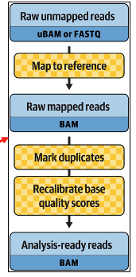

# Data pre-processing for variant discovery (GATK4)

An HPC workflow that pre-processes matched tumor-normal whole-genome sequencing (WGS) FASTQ files into analysis-ready BAMs. See the [GATK documentation](https://gatk.broadinstitute.org/hc/en-us/articles/360035535912-Data-pre-processing-for-variant-discovery) for background.

pipeline:

   

This workflow was written according to the following GATK official WDLs:

Detailed versions:

https://github.com/gatk-workflows/gatk4-genome-processing-pipeline/blob/master/tasks/UnmappedBamToAlignedBam.wdl

https://github.com/gatk-workflows/gatk4-genome-processing-pipeline/blob/master/WholeGenomeGermlineSingleSample.wdl

Simple version:

https://github.com/gatk-workflows/gatk4-data-processing/blob/master/processing-for-variant-discovery-gatk4.wdl

Detailed documents for this simple version: https://github.com/broadgsa/gatk/blob/master/doc_archive/methods/Reference_implementation:_PairedEndSingleSampleWf_pipeline.md#SortAndFixTags

Other tutorials:

[A practical introduction to GATK 4 on Biowulf (NIH HPC)](https://hpc.nih.gov/training/gatk_tutorial/bqsr.html)

[(howto) Recalibrate base quality scores = run BQSR](https://github.com/broadgsa/gatk/blob/master/doc_archive/tutorials/(howto)_Recalibrate_base_quality_scores_%3D_run_BQSR.md)

The main steps in the preprocessing workflow:

### Step 0: Quality control
- [0.1fastqc_pair](0.1fastqc_pair)
- [0.2.1fastqc_trimmomatic_result](0.2.1fastqc_trimmomatic_result.sh)

### Step 1: Fastq to Unmapped BAMs
- [1.1.1fastq-to-unmapped-bam](1.1.1fastq-to-unmapped-bam)
- [validatesam]
- [1.1.2Sortubam](1.1.2Sortubam)

### Step 2: Alignment (BWA)
- [1.2.0BWA](1.2.0BWA)
- [1.2.1Bwasortsam](1.2.1Bwasortsam)
- [1.2.2ValidateAlignedBam]
- [1.2.3CheckIfAltAwareAlign]

### Step 3: Merge and validate
- [1.3.1Mergebam](1.3.1Mergebam)
- [1.3.2Validatebam](1.3.2Validatebam)
- [1.3.3CountReads]

### Step 4: Mark duplicates
- [1.4.0MarkDuplicates](1.4.0MarkDuplicates)
- [1.4.1Sortandfixtag](1.4.1Sortandfixtag)
- [1.4.2ValidateSortedMarkedBam](1.4.2ValidateSortedMarkedBam)

### Step 5: Base quality score recalibration (BQSR)
- [1.5.1Bsqr](1.5.1Bqsr)
- [1.5.2BqsrPlot.sh]
- [1.5.2BqsrPlot.Rmd]