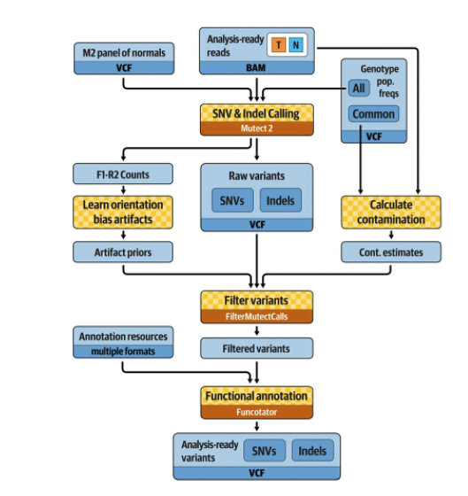

# Somatic SNV and indel calling (Mutect2)

Somatic short-variant discovery on matched tumor-normal WGS BAMs produced by [GATK data pre-processing](../gatk_data_preprocessing/README.md). This is the HPC workflow for calling single nucleotide alteration (SNA) and insertion and deletion (indel) alterations from ~6 childhood acute lymphoblastic leukemia cases. WGS bams were preprocessed. 

The workflow follows the GATK [somatic short variant discovery](https://gatk.broadinstitute.org/hc/en-us/articles/360035894731-Somatic-short-variant-discovery-SNVs-Indels) best practices, scattered across intervals so that one WGS pair finishes in hours rather than days.

 
All scripts are SLURM array jobs written against GATK 4.2.6.1.

### Best practices for somatic short variant discovery. A figure from GITC.: 

   

(I've already created the interval list.)
## Step 1: Scatter interval for Mutect2 parallel calling
- [2.1.1 ScatterInterval](2.1.1scatterInterval.sh)
- [2.1.2 Mutect2ScatterGather0-4](2.1.2scatter0-4)

## Step 2: Gather results from scattered intervals
- [2.1.3 MergeVCFs](2.1.3MergeVCFs)
- [2.1.4 MergeBamOuts](2.1.4MergeBamOuts)
- [2.1.5 MergeStats](2.1.5RMergeStats)

## Step 3: Calculate contamination and learn orientation bias
- [2.2 Contamination](2.2contamination)
- [2.3 OrientationBias](2.3orientationbias)

## Step 4: Filter alignment artifacts
- [2.4.1 FilterMutectCalls](2.4.1filtermutectcall)
- [2.4.2 FilterAlignmentArtifacts](2.4.2FilterAlignmentArtifacts)

## Step 5: Filter variants
- [2.5 Funcotate](2.5funcotate)
- [2.6 BcftoolsFilter](2.6bcffilter)

   ## Step 6: Annotate variants
   - [2.7 ANNOVAR](2.7annovar)
   
FAQ Mutect2: 
How is the Mutect2 filter different in tumor-only mode, versus in matched-normal mode? What does it do differently in each case?

In tumor-normal mode, Mutect2 detects germline variants using (1) the population allele frequency from the germline resource as a prior, (2) the normal reads, and (3) the allele fraction in the tumor (allele fractions near ½ are suggestive of germline hets). In tumor-only mode, the evidence from normal reads is missing, but it’s the same model. Additionally, in tumor-only mode, the powerful normal artifact filter is not available. Mutect2 uses the matched normal to additionally exclude rare germline variation not captured by the germline resource and individual-specific artifacts. Mutect2 uses a germline population resource towards evidence of alleles being germline. The simplified sites-only gnomAD resource retaining allele-specific frequencies is available at ftp://gsapubftp-anonymous@ftp.broadinstitute.org/bundle/Mutect2. A panel of normals (PoN) has a vital role that fills a gap between the matched normal and the population resource. Mutect2 uses the PoN to catch additional sites of noise in sequencing data, like mapping artifacts or other somewhat random but systematic artifacts of sequencing and data processing.